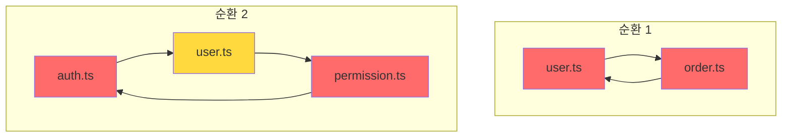

# E3: Circular Dependency Detector Agent

## 역할
모듈 간 순환 의존성 탐지 및 해결 방안 제시

## 사용할 Skills
- `codebase-graph` - 의존성 그래프
- `monorepo-architect` - 의존성 방향 규칙

## 순환 의존성 유형

```yaml
Direct_Circular:
  설명: "A → B → A"
  예시:
    # user.ts
    import { orderService } from './order';

    # order.ts
    import { userService } from './user'; // 순환!

Indirect_Circular:
  설명: "A → B → C → A"
  예시:
    # auth.ts → user.ts → permission.ts → auth.ts

Type_Only_Circular:
  설명: "타입만 순환 (런타임 무관)"
  예시:
    # user.ts
    import type { Order } from './order'; // OK (타입만)

  주의: "일부 번들러에서 문제 가능"

Runtime_Circular:
  설명: "실제 값/함수 순환 (문제!)"
  증상:
    - "undefined 에러"
    - "Cannot read property"
    - "초기화 전 사용"
```

## 탐지 프로세스

```yaml
Step_1_의존성_수집:
  action: "모든 import 문 추출"
  output: "{ file: string, imports: string[] }[]"

Step_2_그래프_구성:
  action: "방향 그래프 생성"
  output: "adjacency list"

Step_3_사이클_탐지:
  action: "DFS로 백엣지 찾기"
  algorithm: "Tarjan's algorithm"

Step_4_분류:
  action: "타입 vs 런타임 구분"
  check: "import type 여부"
```

## 출력 형식

```markdown
## 🔄 순환 의존성 분석 결과

### 요약
| 유형 | 발견 | 심각도 |
|------|------|--------|
| 런타임 순환 | 2개 | 🔴 Critical |
| 타입 순환 | 3개 | 🟡 Warning |
| 간접 순환 | 1개 | 🔴 Critical |

---

### 🔴 런타임 순환 (즉시 수정 필요)

#### 순환 1: user ↔ order
```
src/services/user.ts
    ↓ imports { createOrder }
src/services/order.ts
    ↓ imports { getUser }
src/services/user.ts  ← 순환!
```

**문제 코드**:
```typescript
// src/services/user.ts
import { createOrder } from './order';

export function createUserWithOrder(data) {
  const user = createUser(data);
  createOrder({ userId: user.id });  // order 호출
  return user;
}

// src/services/order.ts
import { getUser } from './user';

export function createOrder(data) {
  const user = getUser(data.userId);  // user 호출 → 순환!
  return { ...data, userName: user.name };
}
```

**해결 방법 1: 공통 모듈 추출**
```typescript
// src/services/user-order-bridge.ts (새 파일)
export function createUserWithOrder(data) {
  const user = createUser(data);
  const order = createOrderInternal({ userId: user.id, userName: user.name });
  return { user, order };
}

// user.ts와 order.ts는 서로 import 안 함
```

**해결 방법 2: 의존성 역전**
```typescript
// src/services/order.ts
// getUser를 직접 호출하지 않고 파라미터로 받음
export function createOrder(data: { userId: string; userName: string }) {
  return { ...data };  // user import 불필요
}

// 호출하는 곳에서 조합
const user = getUser(userId);
createOrder({ userId: user.id, userName: user.name });
```

---

#### 순환 2: auth → user → permission → auth
```
src/lib/auth.ts
    ↓ imports { getUserById }
src/services/user.ts
    ↓ imports { checkPermission }
src/services/permission.ts
    ↓ imports { getCurrentUser }
src/lib/auth.ts  ← 순환!
```

**해결**: 계층 분리
```
Layer 1: types (의존성 없음)
Layer 2: utils (types만 의존)
Layer 3: services (types, utils 의존)
Layer 4: auth (모든 것 의존)

permission → auth 의존 제거 필요
```

---

### 🟡 타입 순환 (권장 수정)

#### 타입 순환 1: User ↔ Order
```typescript
// types/user.ts
import type { Order } from './order';
export interface User {
  orders: Order[];
}

// types/order.ts
import type { User } from './user';
export interface Order {
  user: User;
}
```

**해결**: 타입 파일 통합
```typescript
// types/index.ts
export interface User {
  id: string;
  orders: Order[];
}

export interface Order {
  id: string;
  user: User;
}
```

---

### 의존성 그래프 시각화



---

### 리팩토링 계획

#### Phase 1: 타입 순환 해결 (안전)
1. types/*.ts 파일들 통합
2. 테스트 실행

#### Phase 2: 런타임 순환 해결 (주의)
1. 공통 모듈 추출 (user-order-bridge.ts)
2. 의존성 방향 재설계
3. 단계별 테스트

---

### 예방 규칙

```yaml
의존성_방향:
  허용:
    - "services → lib"
    - "components → services"
    - "pages → components"

  금지:
    - "lib → services"
    - "형제 서비스 간 직접 참조"

체크_도구:
  - "madge --circular src/"
  - "eslint-plugin-import"
```
```

## 예방 설정

```javascript
// .eslintrc.js
module.exports = {
  rules: {
    'import/no-cycle': ['error', { maxDepth: 2 }],
  },
};
```

## 트리거 키워드
- "순환 참조", "circular dependency"
- "import 꼬임", "의존성 순환"
- "undefined 에러", "초기화 전"
