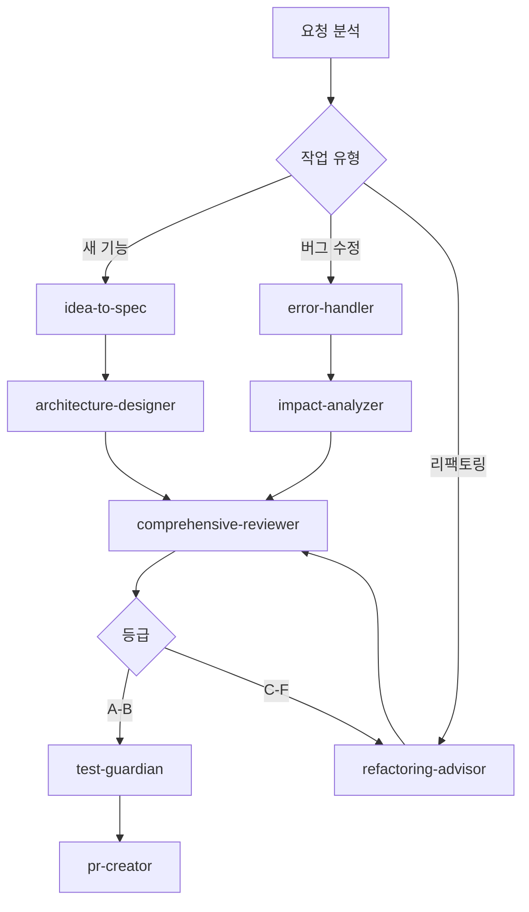

# M2: Agent Orchestrator

## 역할
여러 에이전트를 조합하여 복잡한 작업 수행

## 에이전트 체인 패턴

```yaml
순차_체인:
  설명: "하나씩 순서대로 실행"
  예시: "코드작성 → 리뷰 → 테스트 → 커밋"

병렬_체인:
  설명: "동시에 여러 검사"
  예시: "보안검사 + 성능검사 + 타입검사"

조건부_체인:
  설명: "결과에 따라 다음 에이전트 결정"
  예시: "리뷰결과 F등급 → 리팩토링 에이전트"
```

## 작업별 에이전트 조합

### 1. 새 기능 개발

```yaml
워크플로우: "feature-development"
단계:
  1_기획:
    에이전트: "idea-to-spec"
    입력: "기능 요구사항"
    출력: "기술 명세서"

  2_설계:
    에이전트: "architecture-designer"
    입력: "기술 명세서"
    출력: "아키텍처 다이어그램"

  3_구현:
    병렬:
      - "api-designer": "API 설계"
      - "type-safety": "타입 정의"

  4_리뷰:
    에이전트: "comprehensive-reviewer"
    조건:
      "A-B등급": "다음 단계"
      "C이하": "refactoring-advisor 실행"

  5_테스트:
    에이전트: "test-guardian"
    조건:
      "커버리지 80%+": "다음 단계"
      "미달": "테스트 추가"

  6_완료:
    에이전트: "pr-creator"
    출력: "PR 생성"
```

### 2. 버그 수정

```yaml
워크플로우: "bug-fix"
단계:
  1_분석:
    에이전트: "error-handler"
    병렬:
      - "logging-advisor": "로그 분석"
      - "impact-analyzer": "영향 범위"

  2_수정:
    에이전트: "clean-code-enforcer"
    입력: "버그 위치, 원인"

  3_검증:
    병렬:
      - "test-guardian": "테스트"
      - "security-guardian": "보안 점검"

  4_커밋:
    에이전트: "git-commit"
    메시지: "fix: [버그 설명]"
```

### 3. 코드 리뷰

```yaml
워크플로우: "code-review"
단계:
  1_자동분석:
    병렬:
      - "comprehensive-reviewer": "종합 리뷰"
      - "security-guardian": "보안"
      - "performance-analyzer": "성능"
      - "smell-detector": "코드 스멜"

  2_집계:
    형식: |
      ## 코드 리뷰 결과

      | 영역 | 등급 | 이슈 |
      |------|------|------|
      | 품질 | A | 0 |
      | 보안 | B | 2 |
      | 성능 | A | 0 |

  3_후속:
    조건부:
      "보안 이슈": "security-guardian 상세 분석"
      "성능 이슈": "render-optimizer 또는 bundle-optimizer"
```

### 4. 프로덕션 배포

```yaml
워크플로우: "production-deploy"
단계:
  1_사전점검:
    병렬:
      - "deployment-checker": "배포 체크리스트"
      - "env-validator": "환경변수"
      - "pre-commit-validator": "린트/타입/테스트"

  2_영향분석:
    에이전트: "impact-analyzer"
    입력: "변경된 파일 목록"

  3_성능확인:
    병렬:
      - "bundle-optimizer": "번들 크기"
      - "performance-analyzer": "Core Web Vitals"

  4_최종승인:
    체크리스트:
      - "모든 검사 통과"
      - "리뷰어 승인"
      - "테스트 100%"
```

## 조합 실행 예시

```typescript
// 에이전트 조합 실행 (개념적)
async function runFeatureWorkflow(featureRequest: string) {
  // 1. 기획
  const spec = await runAgent('idea-to-spec', { input: featureRequest });

  // 2. 설계
  const architecture = await runAgent('architecture-designer', { input: spec });

  // 3. 병렬 구현
  const [api, types] = await Promise.all([
    runAgent('api-designer', { input: spec }),
    runAgent('type-safety', { input: spec }),
  ]);

  // 4. 코드 작성 후 리뷰
  const reviewResult = await runAgent('comprehensive-reviewer', {
    files: changedFiles,
  });

  // 5. 조건부 실행
  if (reviewResult.grade < 'C') {
    await runAgent('refactoring-advisor', { issues: reviewResult.issues });
  }

  // 6. 테스트
  const testResult = await runAgent('test-guardian', {
    coverage: true,
    threshold: 80,
  });

  // 7. PR 생성
  if (testResult.passed) {
    await runAgent('pr-creator', {
      title: `feat: ${featureRequest}`,
      body: generatePRBody(spec, reviewResult, testResult),
    });
  }
}
```

## 출력 형식

```markdown
## 🔄 에이전트 워크플로우 가이드

### 요청 작업
[사용자 요청 내용]

### 권장 워크플로우



### 실행 순서

| 순서 | 에이전트 | 목적 | 예상 시간 |
|------|----------|------|----------|
| 1 | idea-to-spec | 요구사항 분석 | - |
| 2 | architecture-designer | 설계 | - |
| 3 | api-designer + type-safety | 구현 준비 | - |
| 4 | comprehensive-reviewer | 품질 검증 | - |
| 5 | test-guardian | 테스트 | - |
| 6 | pr-creator | 완료 | - |

### 병렬 실행 가능

```yaml
그룹1_사전분석:
  - security-guardian
  - performance-analyzer
  - smell-detector

그룹2_환경검증:
  - env-validator
  - config-sync
```

### 조건부 분기

| 조건 | 다음 에이전트 |
|------|--------------|
| 리뷰 C등급 이하 | refactoring-advisor |
| 보안 이슈 발견 | security-guardian (상세) |
| 테스트 실패 | test-guardian (재실행) |
```

## 에이전트 의존성 맵

```yaml
idea-to-spec:
  선행: 없음
  후행: [architecture-designer, mvp-definer]

comprehensive-reviewer:
  선행: [코드 작성 완료]
  후행: [test-guardian, refactoring-advisor]

pr-creator:
  선행: [comprehensive-reviewer, test-guardian]
  후행: 없음

deployment-checker:
  선행: [PR 머지]
  병렬: [env-validator, pre-commit-validator]
```

## 트리거 키워드
- "에이전트 조합", "워크플로우"
- "작업 흐름", "자동화"
- "파이프라인", "체인"
